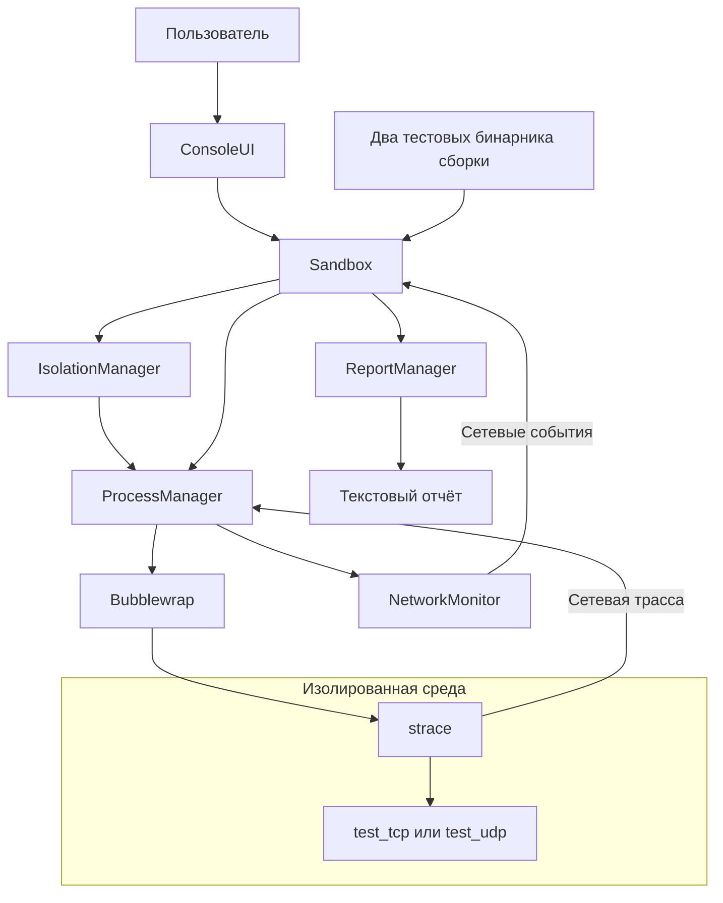
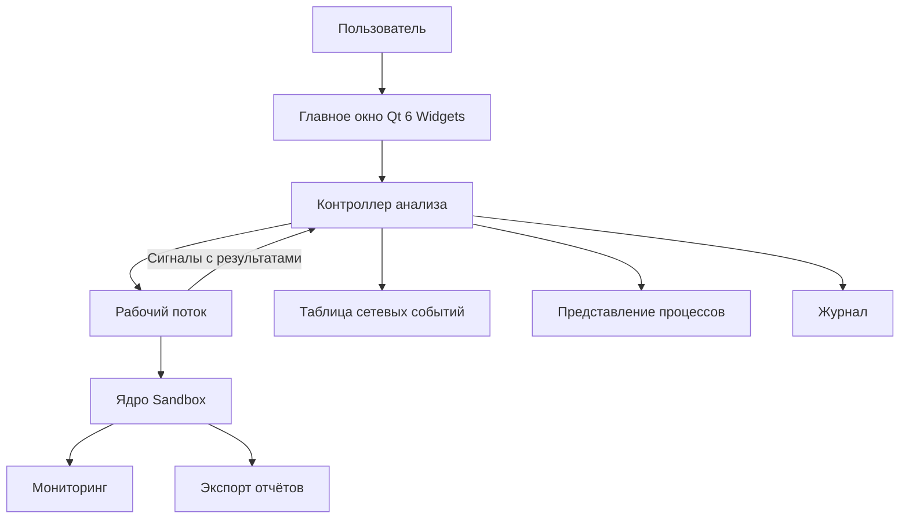

# Архитектура LinuxSandbox

## Версия 0.1

- **ConsoleUI** читает команды и отображает данные ядра. **Sandbox** хранит выбранный файл, результат последнего анализа и журнал сеанса.
- **Sandbox** читает метаданные файла и проверяет путь и содержимое комплектного бинарника. CMake встраивает эталонные байты двух тестов в LinuxSandbox.
- **IsolationManager** формирует вызов Bubblewrap. В среду попадают системные библиотеки и strace в режиме чтения, приватные `/proc`, `/dev` и проверенная копия образца. Каталог проекта и домашний каталог не монтируются.
- **ProcessManager** передаёт образец через временный файловый дескриптор, контролирует завершение Bubblewrap и считывает трассу и диагностику. При истечении пяти секунд он завершает Bubblewrap. Параметр `--die-with-parent` связывает время жизни процессов среды с Bubblewrap.
- **NetworkMonitor** преобразует завершённые сетевые вызовы strace в события. **ReportManager** сохраняет текст отчёта в новый файл с правами `0600`.

## Перспектива с Qt 6 Widgets

Графическое окно будет обращаться к ядру через контроллер. Анализ будет выполняться в рабочем потоке, а результаты будут передаваться в поток интерфейса.

Описание параметров инструментов доступно в документации проектов. [Bubblewrap](https://github.com/containers/bubblewrap/blob/main/bwrap.xml) · [strace](https://strace.io/)
